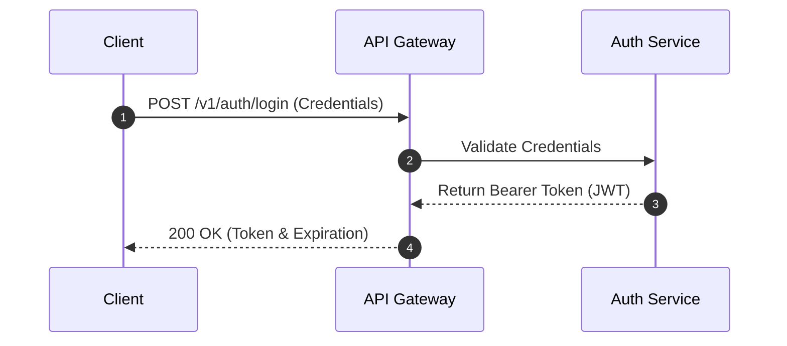

# Hi, I'm Thomas Walton 👋

> **Technical Writer & Documentation Specialist**  
> Bridging the gap between software engineering and user documentation using Docs-as-Code workflows.

---

## 🛠️ Core Competencies & Tools

- **Documentation & Workflows:** Docs-as-Code, API References, User Guides, Style Guides (`STYLE.md`)
- **Version Control & Authoring:** Git, GitHub (PRs, Code Reviews, Branching), VS Code, Markdown
- **Environments & Scripting:** Linux CLI (Bash), Python, HTML/CSS

---

## 📂 Featured Portfolio Repositories

| Repository / Project | Focus Area | Description |
| :--- | :--- | :--- |
| **[API-Doc-Samples](https://github.com/Thomas-Walton/api-doc-samples)** | API Reference & Guides | REST API walkthroughs, curl requests, and Mermaid.js sequence diagrams. |
| **[CLI-Tool-Docs](https://github.com/Thomas-Walton/cli-tool-docs)** | Developer Quickstarts | Command-line installation guides, troubleshooting tables, and flag references. |

---

## 📌 Featured Work Sample Preview

Below is a snapshot of an architecture flowchart rendered natively using **Mermaid.js**:

---
### Connect with Tom
[LinkedIn](https://www.linkedin.com/in/4hire)
